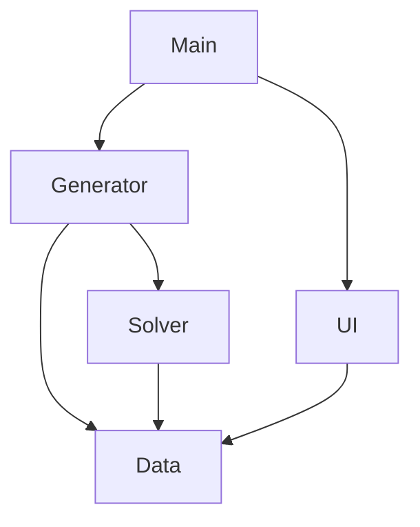
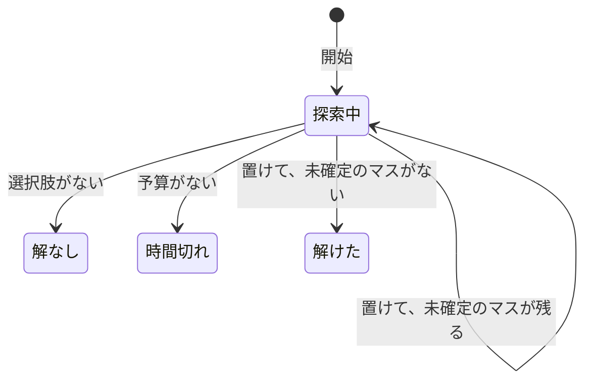

# Design

## module の構成

- `Solver`、`Generator`、`UI` はどれも `Data` に依存する。
- `Data`、`Solver`、`Generator` は `UI` に依存しない。
- 部分を組み合わせるのは `Main` だけにする。
- `Internal` を import するのは、その公開 module と test、内部の性能を測る bench だけにする。

## Solver の設計

solver を状態機械として設計する。実装では、状態を型に、遷移を関数に対応させる。

### 用語

- **部分盤面**: 各マスが、次のどちらかである盤面。
  - **確定**: 数字が 1 つ決まっている。
  - **未確定**: 空でない候補集合を持つ。
- **置く**: 未確定のマスを、その候補の 1 つの数字で確定する。同時に、そのマスの peer である未確定のマスの候補から、その数字を消す。
- **選択肢**: 部分盤面、その中の未確定のマス 1 つ、そのマスにまだ試していない数字（1 つ以上）の組。
- **完成盤**: 次をすべて満たす盤面。
  - 全マスが埋まっている。
  - peer 同士の数字が互いに異なる。
  - 入力で埋まっていたマスの数字をそのまま持つ。
- **予算**: 残りの遷移の回数。1 回の遷移で置くのは 1 回だけで、その計算量はほぼ一定なので、計算時間の近似になる。

### 状態

| 状態     | 持つもの                           | 意味                                                           |
| -------- | ---------------------------------- | -------------------------------------------------------------- |
| 探索中   | 選択肢の列（先頭が最も深い）、予算 | 完成盤があれば、列に残っている選択肢のどれかを経由して見つかる |
| 解けた   | 完成盤                             | 終了                                                           |
| 時間切れ | なし                               | 終了。完成盤の有無はわからない                                 |
| 解なし   | なし                               | 終了。完成盤は存在しない                                       |

終了状態（解けた・時間切れ・解なし）から出る遷移はない。

### 遷移

「探索中」から出る遷移は、上から順に判定する。置く遷移は、どれも予算を 1 消費する。

| 遷移                       | 条件                                                        | 結果                                                                                                                                                                          |
| -------------------------- | ----------------------------------------------------------- | ----------------------------------------------------------------------------------------------------------------------------------------------------------------------------- |
| 開始                       | 入力盤面を受け取る                                          | 全マスが未確定の部分盤面を作る。候補は、入力で数字 `d` があるマスなら `{d}`、空きマスなら 9 つの数字すべてとする。候補が最少のマスについての選択肢 1 つを持つ「探索中」になる |
| 選択肢がない               | 選択肢の列が空                                              | 解なし                                                                                                                                                                        |
| 予算がない                 | 予算が 0                                                    | 時間切れ                                                                                                                                                                      |
| 置けない                   | 先頭の選択肢の数字を 1 つ置くと、候補が空になるマスができる | その数字を選択肢から除く（数字が尽きた選択肢は列から除く）                                                                                                                    |
| 置けて、未確定のマスが残る | 置いても候補が空になるマスがなく、未確定のマスが残る        | その数字を選択肢から除いたうえで、置いた後の部分盤面で候補が最少のマスについての選択肢を、列の先頭に加える                                                                    |
| 置けて、未確定のマスがない | 置いても候補が空になるマスがなく、未確定のマスがない        | 解けた（置いた後の部分盤面が、そのまま完成盤になる）                                                                                                                          |

- 「開始」では、入力の重複を検査しない。全マスに空でない候補があるので、開始は必ず「探索中」になる。
- 入力で埋まっていたマスも、他のマスと同じく、置く遷移で確定する。候補が 1 つなので先に選ばれる。
- 入力に重複があると、先に置いた方の数字が、後のマスの候補 `{d}` から消える。そのため、そのマスを置くことはできず、最終的に「解なし」になる。
- 「選択肢がない」を「予算がない」より先に判定する。そのため、選択肢が尽きていれば、予算が 0 でも「解なし」になる。

### 不変条件

「探索中」の列にあるすべての部分盤面について、次が成り立つ。

- **I1** 未確定のマスの候補は空でない。
- **I2** peer 同士の確定のマスの数字は、互いに異なる。
- **I3** 未確定のマスの候補は、その peer である確定のマスの数字を含まない。
- **I4** 入力で数字 `d` があったマスは、確定なら `d`、未確定なら候補が `{d}` である。
- **I5** 確定のマスの数字と一致する完成盤は、どれも各未確定のマスに、そのマスの候補のどれかを置いている。

開始時の部分盤面は、I1〜I5 を満たす。置く遷移は、I1〜I5 を保つ。I1 が破れる場合は「置けない」に進む。

### 終了状態が正しい理由

- **解けた**: 未確定のマスがないので、I2 から peer 同士の数字が異なる。I4 から、入力の数字が保たれる。したがって完成盤である。
- **解なし**: I5 から、どの完成盤も、列のいずれかの選択肢の数字を経由する。「置けない」で除いた数字を経由する完成盤はない。列が空になるのは、すべての選択肢を試し終えたときだけである。
- **時間切れ**: 時間切れに進むのは「予算がない」の遷移だけで、終了状態から出る遷移はない。したがって、時間切れが他の結果にすり替わることはない。
